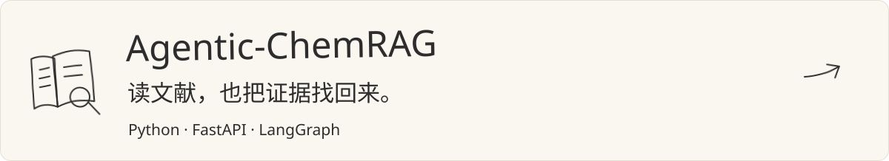
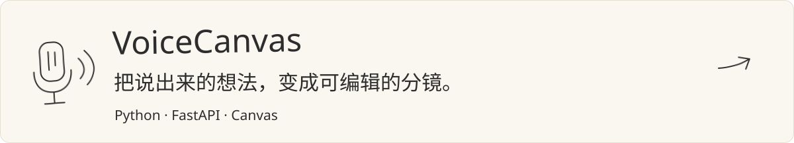

<picture>
    <source media="(max-width: 600px)" srcset="./assets/notes-hero-mobile.svg">
    
  </picture>

# 于文涛｜AI 应用开发 · Agent 工程化

材料科学与工程硕士在读（2027 届）。切入 AI Agent 工程化的起点，源于读科研文献时一个真实痛点：当大模型给出一个材料合成或性能结论时，我必须知道证据究竟落在原文哪一页、哪一张图注里。

<picture>
    <source media="(max-width: 600px)" srcset="./assets/notes-projects-mobile.svg">
    
  </picture>

### [Trusted-Memory](https://github.com/jackwentao/Trusted-Memory)

> **Agent 长期记忆 · 开发中**
>
> 当用户更新一条事实，系统怎样找回当前状态，又怎样还原过去？项目设计围绕事件时间、写入时间、旧记忆溯源与写入防护展开。

[架构设计（README 待发布）](https://github.com/jackwentao/Trusted-Memory) · [量化评测（eval/ 待发布）](https://github.com/jackwentao/Trusted-Memory)

### [Agentic-ChemRAG](https://github.com/jackwentao/Agentic-ChemRAG)

<a href="https://github.com/jackwentao/Agentic-ChemRAG">
<picture>
    <source media="(max-width: 600px)" srcset="./assets/notes-chemrag-mobile.svg">
    
  </picture>
</a>

基于化学与材料领域的精选科技文献验证集，从 PDF 解析、画像筛选到篇内取证与引用定位完成离线检索评测，覆盖跨文献筛选、材料实体匹配及图注证据检索。文档 Recall@5 为 [87.5%](https://github.com/jackwentao/Agentic-ChemRAG/blob/main/scripts/evaluate_profile_refactor.py)，页级引用命中率为 [91.7%](https://github.com/jackwentao/Agentic-ChemRAG/blob/main/docs/reports/profile-retrieval.md)。

[架构设计](https://github.com/jackwentao/Agentic-ChemRAG/blob/main/docs/ARCHITECTURE.md) · [评测报告](https://github.com/jackwentao/Agentic-ChemRAG/tree/main/docs/reports)

### [VoiceCanvas](https://github.com/jackwentao/VoiceCanvas)

<a href="https://github.com/jackwentao/VoiceCanvas">
<picture>
    <source media="(max-width: 600px)" srcset="./assets/notes-voicecanvas-mobile.svg">
    
  </picture>
</a>

一句话语音或文本生成多镜头分镜 → 局部编辑修改 → 导出画面。下面是「雨天咖啡」从镜头预览、改字到导回 SVG 的连续截图。

| 多镜头分镜 | 局部改字 | 导出后重新导入 |
| --- | --- | --- |
|  |  |  |

[架构设计](https://github.com/jackwentao/VoiceCanvas/blob/main/docs/ARCHITECTURE.md) · [播放雨天咖啡演示](https://raw.githubusercontent.com/jackwentao/VoiceCanvas/main/docs/demo/voicecanvas-demo.mp4) · Cloudflare 在线体验（待部署）

## 工具与技术笔记

<picture>
    <source media="(max-width: 600px)" srcset="./assets/notes-tools-mobile.svg">
    
  </picture>

<a href="https://github.com/jackwentao/Git-Weekly-Insight">
<picture>
    <source media="(max-width: 600px)" srcset="./assets/notes-weekly-mobile.svg">
    
  </picture>
</a>

<a href="https://github.com/jackwentao/blog">
<picture>
    <source media="(max-width: 600px)" srcset="./assets/notes-writing-mobile.svg">
    
  </picture>
</a>

[技术笔记](https://github.com/jackwentao/blog) · [CSDN](https://blog.csdn.net/Yulovelwj) · [完整项目导航](PROJECTS.md)
