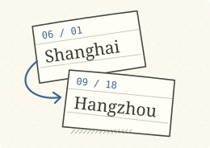
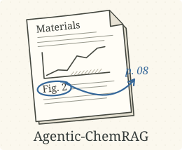

## 项目手记

### [Trusted-Memory](https://github.com/jackwentao/Trusted-Memory)

**Agent 长期记忆** · 区分事件发生和记忆写入的时间，追踪同一条事实如何随时间更新。开发中。

 

### [Agentic-ChemRAG](https://github.com/jackwentao/Agentic-ChemRAG)

**材料文献问答** · 从正文和图注检索证据，把回答定位到 PDF 原页。离线评测引用页命中率 91.7%。[评测报告](https://github.com/jackwentao/Agentic-ChemRAG/tree/main/docs/reports)

 

### [VoiceCanvas](https://github.com/jackwentao/VoiceCanvas)

**语音分镜创作** · 说一句话生成分镜，逐镜修改画面和字幕，再导出成图。[观看「雨天咖啡」演示](https://raw.githubusercontent.com/jackwentao/VoiceCanvas/main/docs/demo/voicecanvas-demo.mp4)

 
