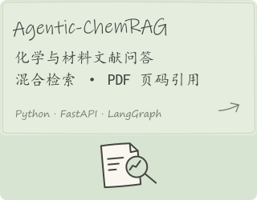
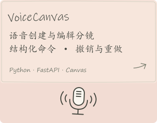

<picture><source media="(max-width: 600px)" srcset="./assets/notes-hero-mobile.svg"></picture>

**AI 应用开发 · Agent 工程化** ｜ 材料科学与工程硕士在读（2027 届）。切入 AI 工程化的起点，源于科研文献阅读中的一个真实痛点：*当大模型给出一个材料合成或性能结论时，我必须知道证据究竟落在原文哪一页、哪一张图注里。*

<picture><source media="(max-width: 600px)" srcset="./assets/notes-tools-mobile.svg"></picture>

### 🚀 Featured Projects

<table width="100%" border="0">
  <tr>
    <td width="340" align="center" valign="middle"></td>
    <td valign="top">
      <h3><a href="https://github.com/jackwentao/Trusted-Memory">Trusted-Memory</a> — Agent 长期记忆安全与治理系统</h3>
      
面向生产级多轮对话 Agent 的高可信记忆中台，解决动态事实冲突、时间衰减与恶意注入难题。

      <ul>
        <li><strong>双时间戳冲突消解：</strong> 严格区分事件发生时间（<code>event_time</code>）与写入时间（<code>ingest_time</code>），结合时间衰减公式实现状态更新与历史版本精准溯源。</li>
        <li><strong>写入安全防火墙：</strong> 持久化前置安全拦截中间件，实现敏感信息（PII）自动脱敏与 Prompt Injection 记忆投毒检测。</li>
        <li>👉 <strong><a href="https://github.com/jackwentao/Trusted-Memory">项目源码与架构设计</a></strong> · <strong><a href="https://github.com/jackwentao/Trusted-Memory#evaluation">基准评测报告</a></strong></li>
      </ul>
    </td>
  </tr>
  <tr>
    <td width="340" align="center" valign="middle"></td>
    <td valign="top">
      <h3><a href="https://github.com/jackwentao/Agentic-ChemRAG">Agentic-ChemRAG</a> — 面向化学与材料文献的可溯源 RAG 工作台</h3>
      
解决科研文献“多栏排版复杂、图表密度高、回答无法核对原页”的端到端智能检索工作台。

      <ul>
        <li><strong>有界多跳编排与双通道解析：</strong> 基于 <code>LangGraph</code> 状态机编排与 <code>Celery</code> 异步管线，实现 PDF 版面解析、图像提取与正文/图注协同检索。</li>
        <li><strong>混合检索与原页高亮溯源：</strong> 基于 <code>PostgreSQL (pgvector)</code> 与 <code>BGE-M3</code> 实现混合检索与重排，在覆盖多栏混排、跨页图注取证及跨文献多跳对比的高密度科技文献验证集上，实现文档 <strong>Recall@k 达 87.5%</strong>，<strong>引用页命中率达 91.7%</strong>。</li>
        <li>👉 <strong><a href="https://github.com/jackwentao/Agentic-ChemRAG">项目源码</a></strong> · <strong><a href="https://github.com/jackwentao/Agentic-ChemRAG#architecture">架构设计</a></strong> · <strong><a href="https://github.com/jackwentao/Agentic-ChemRAG#evaluation">评测报告</a></strong></li>
      </ul>
    </td>
  </tr>
  <tr>
    <td width="340" align="center" valign="middle"></td>
    <td valign="top">
      <h3><a href="https://github.com/jackwentao/VoiceCanvas">VoiceCanvas</a> — 全双工语音驱动的智能生图与分镜画布</h3>
      
让自然语言指令直接转化为可编辑多镜头分镜的交互式创作工作台。

      <ul>
        <li><strong>语音/文本双模闭环：</strong> 集成 ASR 意图解析与 Function Calling 结构化指令分发，一句话生成多镜头分镜草图并支持流式语音反馈。</li>
        <li><strong>可控画布局部编辑：</strong> 支持单镜头字幕修改、图层顺序调整、完整撤销重做（Undo/Redo）以及 <code>PNG / SVG / JSON</code> 多格式无损导出与回导。</li>
        <li>👉 <strong><a href="https://github.com/jackwentao/VoiceCanvas">项目源码与架构</a></strong> · <strong><a href="https://github.com/jackwentao/VoiceCanvas#demo">「雨天咖啡」演示</a></strong> · <strong><a href="https://github.com/jackwentao/VoiceCanvas">在线体验</a></strong></li>
      </ul>
    </td>
  </tr>
</table>

Focused on building reliable, traceable, and production-ready AI Agent systems.

