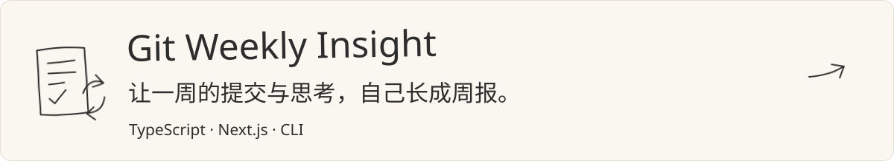

<picture>
    <source media="(max-width: 600px)" srcset="./assets/notes-hero-mobile.svg">
    
  </picture>

# 于文涛｜AI 应用开发 · Agent 工程化

材料科学与工程硕士在读（2027 届）。切入 AI Agent 工程化的起点，源于读科研文献时一个真实痛点：当大模型给出一个材料合成或性能结论时，我必须知道证据究竟落在原文哪一页、哪一张图注里。

<picture>
    <source media="(max-width: 600px)" srcset="./assets/notes-tools-mobile.svg">
    
  </picture>

<picture>
    <source media="(max-width: 600px)" srcset="./assets/notes-projects-mobile.svg">
    
  </picture>

### [Trusted-Memory](https://github.com/jackwentao/Trusted-Memory)

**Agent 长期记忆。** 架构设计区分事件发生时间与记忆写入时间，将记忆更新、历史版本溯源和写入防护纳入同一条读写链路。评测围绕三个问题展开：当前状态是否准确、冲突记录能否追溯、检索需要多长时间。

[架构设计](https://github.com/jackwentao/Trusted-Memory#architecture) · [量化评测](https://github.com/jackwentao/Trusted-Memory#evaluation)

### [Agentic-ChemRAG](https://github.com/jackwentao/Agentic-ChemRAG)

**化学与材料文献问答。** 先按文档画像筛选论文，再从正文和图注取证，把回答对应到 PDF 原页。离线评测中文档 Recall@k 达 [87.5%][recall]，引用页命中率达 [91.7%][citation]。

[架构设计](https://github.com/jackwentao/Agentic-ChemRAG/blob/main/docs/ARCHITECTURE.md) · [评测报告](https://github.com/jackwentao/Agentic-ChemRAG/tree/main/docs/reports)

[recall]: https://github.com/jackwentao/Agentic-ChemRAG/blob/main/scripts/evaluate_profile_refactor.py
[citation]: https://github.com/jackwentao/Agentic-ChemRAG/blob/main/docs/reports/profile-retrieval.md

### [VoiceCanvas](https://github.com/jackwentao/VoiceCanvas)

**语音与文本分镜创作。** 用一句话生成多镜头分镜，选中单个镜头修改字幕或画面，再导出 PNG 或 SVG。「雨天咖啡」演示展示了从预览、改字到重新导入的过程。

| 多镜头分镜 | 局部改字 | 导出后重新导入 |
| --- | --- | --- |
|  |  |  |

[架构设计](https://github.com/jackwentao/VoiceCanvas/blob/main/docs/ARCHITECTURE.md) · [播放雨天咖啡演示](https://raw.githubusercontent.com/jackwentao/VoiceCanvas/main/docs/demo/voicecanvas-demo.mp4)

## 工具与技术笔记

<a href="https://github.com/jackwentao/Git-Weekly-Insight">
<picture>
    <source media="(max-width: 600px)" srcset="./assets/notes-weekly-mobile.svg">
    
  </picture>
</a>

<a href="https://github.com/jackwentao/blog">
<picture>
    <source media="(max-width: 600px)" srcset="./assets/notes-writing-mobile.svg">
    
  </picture>
</a>

[技术笔记](https://github.com/jackwentao/blog) · [完整项目导航](PROJECTS.md)
