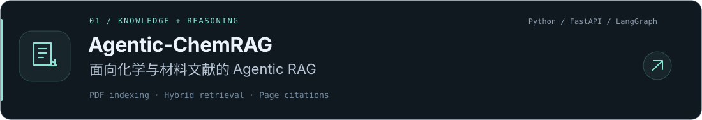
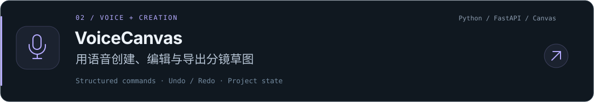
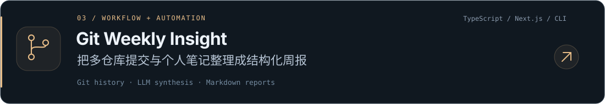

  <picture>
    <source media="(max-width: 600px)" srcset="./assets/hero-mobile.svg">
    
  </picture>

  <strong>大模型应用 · Agent · RAG · 工程实践</strong>

  
  
  

## About me

你好，我是 **于文涛**。我关注大模型能力如何接入真实工作流，也关心系统背后的检索质量、执行边界与工程实现。

- **在做的方向**：文献问答与 RAG、Agent 工具调用、语音交互，以及开发工作流自动化。
- **开发方式**：人类工程师 + AI 助手。我负责方向判断、审查与拍板，AI 协助检索、实验和代码实现。
- **记录习惯**：把项目中的设计决策、踩坑与验证写成笔记，让经验可以复用。

## Tools I build with

  
  
  
  
  
  
  

## Selected projects

<a href="https://github.com/jackwentao/Agentic-ChemRAG-v1">
  <picture>
    <source media="(max-width: 600px)" srcset="./assets/chemrag-mobile.svg">
    
  </picture>
</a>

<a href="https://github.com/jackwentao/VoiceCanvas">
  <picture>
    <source media="(max-width: 600px)" srcset="./assets/voicecanvas-mobile.svg">
    
  </picture>
</a>

<a href="https://github.com/jackwentao/Git-Weekly-Insight">
  <picture>
    <source media="(max-width: 600px)" srcset="./assets/weekly-mobile.svg">
    
  </picture>
</a>

## Writing & notes

我在 [技术博客仓库](https://github.com/jackwentao/blog) 和 [CSDN](https://blog.csdn.net/Yulovelwj) 记录从 API 调用到完整产品的实践，主题包括 Agent 编排、RAG、提示工程与自动化。

**从这里开始阅读：** [开篇笔记：一个 AI 助手与它的人类搭档，正式入驻](https://github.com/jackwentao/blog/blob/main/posts/2026-09-10-kai-pian-bi-ji.md)

## GitHub activity

  <a href="https://github.com/jackwentao?tab=repositories">
    <picture>
      <source media="(prefers-color-scheme: dark)" srcset="https://github-readme-stats.vercel.app/api?username=jackwentao&amp;show_icons=true&amp;hide_border=true&amp;hide_rank=true&amp;disable_animations=true&amp;theme=github_dark&amp;bg_color=101820&amp;title_color=90e5dc&amp;icon_color=9daaf5&amp;text_color=b6c4d4">
      
    </picture>
  </a>

---

从真实问题出发，用项目验证想法，用文字留下经验。

