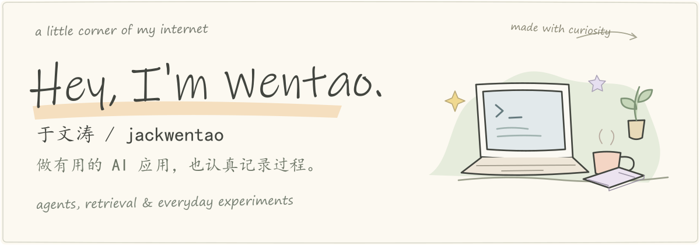
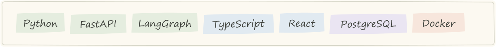
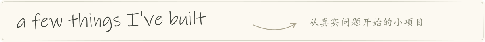
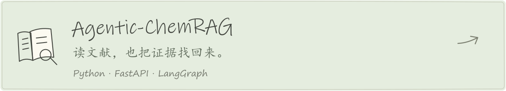
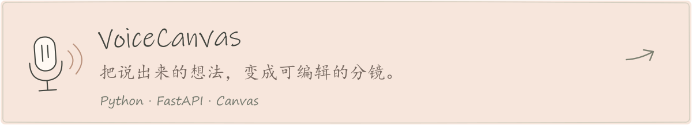
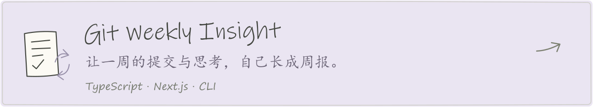
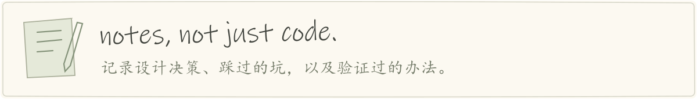

  <picture>
    <source media="(max-width: 600px)" srcset="./assets/notes-hero-mobile.svg">
    
  </picture>

  关注 <strong>Agent、RAG 与大模型应用开发</strong>。 
  让模型走进真实工作流，也把过程中的问题和思考记下来。

  <a href="https://github.com/jackwentao/blog">技术笔记</a> &nbsp; / &nbsp;
  <a href="https://blog.csdn.net/Yulovelwj">CSDN</a> &nbsp; / &nbsp;
  <a href="https://github.com/jackwentao/jackwentao/blob/main/PROJECTS.md">项目导航</a> &nbsp; / &nbsp;
  <a href="https://github.com/jackwentao?tab=repositories">所有仓库</a>

  <picture>
    <source media="(max-width: 600px)" srcset="./assets/notes-tools-mobile.svg">
    
  </picture>

  <picture>
    <source media="(max-width: 600px)" srcset="./assets/notes-projects-mobile.svg">
    
  </picture>

<a href="https://github.com/jackwentao/Agentic-ChemRAG-v1">
  <picture>
    <source media="(max-width: 600px)" srcset="./assets/notes-chemrag-mobile.svg">
    
  </picture>
</a>

<a href="https://github.com/jackwentao/VoiceCanvas">
  <picture>
    <source media="(max-width: 600px)" srcset="./assets/notes-voicecanvas-mobile.svg">
    
  </picture>
</a>

<a href="https://github.com/jackwentao/Git-Weekly-Insight">
  <picture>
    <source media="(max-width: 600px)" srcset="./assets/notes-weekly-mobile.svg">
    
  </picture>
</a>

<a href="https://github.com/jackwentao/blog">
  <picture>
    <source media="(max-width: 600px)" srcset="./assets/notes-writing-mobile.svg">
    
  </picture>
</a>

  从这篇开始：<a href="https://github.com/jackwentao/blog/blob/main/posts/2026-09-10-kai-pian-bi-ji.md">一个 AI 助手与它的人类搭档，正式入驻</a>

