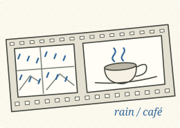

### [Trusted-Memory](https://github.com/jackwentao/Trusted-Memory) · Agent 长期记忆

同一个人的居住地可能随时间变化。项目区分事件发生时间和记忆写入时间，探索如何检索当前状态、保留历史版本，并追溯冲突记录。开发中。

### [Agentic-ChemRAG](https://github.com/jackwentao/Agentic-ChemRAG) · 材料文献问答

从论文正文和图注检索证据，将回答定位到 PDF 原页。离线评测中，文档 Recall@k 为 87.5%，引用页命中率为 91.7%。[架构设计](https://github.com/jackwentao/Agentic-ChemRAG/blob/main/docs/ARCHITECTURE.md) · [评测报告](https://github.com/jackwentao/Agentic-ChemRAG/tree/main/docs/reports)

### [VoiceCanvas](https://github.com/jackwentao/VoiceCanvas) · 语音分镜创作

用一句话生成多镜头分镜，选中单个镜头修改字幕或画面，再导出 PNG 或 SVG。[观看「雨天咖啡」演示](https://raw.githubusercontent.com/jackwentao/VoiceCanvas/main/docs/demo/voicecanvas-demo.mp4)

